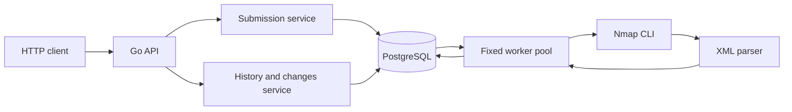
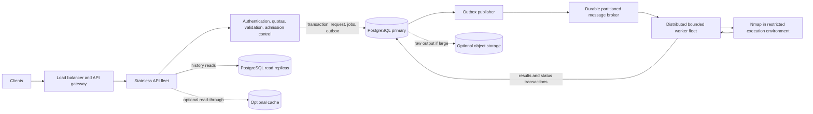

# Nmap REST API — Architecture and Scalability

## 1. Current MVP architecture

The API and worker pool run in one Go process. PostgreSQL stores requests, target jobs, scan results, and port observations; it also acts as the durable work queue. The API returns after persisting a batch, while a fixed number of workers poll for jobs and execute Nmap asynchronously. The current implementation is a local MVP, not a high-volume deployment.

The API validates requests and reads data; services hold business rules; the repository owns SQL and transactions; workers coordinate processing; and the Nmap package runs/parses scans. Nmap observations describe what the scanner sees on the network. The application does not inspect or modify firewall rules.

## 2. Current scan lifecycle

1. `POST /api/v1/scans` is decoded and validated as one complete batch. It accepts IP addresses or syntactically valid hostnames that match the exact-target allowlist. DNS is not checked during request validation.
2. One transaction inserts a `scan_requests` row and one pending `scan_jobs` row per target. The API returns `202 Accepted` after commit, with a request UUID and pending target entries; it does not wait for Nmap.
3. A worker claims one job in a short transaction with `FOR UPDATE SKIP LOCKED`, changes its status to running, increments its attempt count, and sets a lease. Nmap runs after the transaction ends.
4. Nmap's XML is parsed into host/IP/port observations. The worker persists result rows, port rows, job completion, and aggregate request status transactionally.
5. Execution errors, XML errors, and persistence errors mark an active job failed; the configured scan timeout marks it timed out. A host reported down is an observation and is not by itself a failed job. Jobs are independent, so one target failure does not cancel other targets in the batch.

Each worker processes one job at a time; the default worker count is four. Thus target scans can run concurrently, but their total active count within this process is bounded by the configured worker count. There is no request-status endpoint: aggregate request status is stored in PostgreSQL, while per-job status can also appear in target history.

## 3. Current database design

The initial migration creates four tables:

- `scan_requests`: groups a submitted batch, stores a unique UUID and aggregate status.
- `scan_jobs`: one row per target, linked to a request; includes target/type, status, timeout, attempts, timestamps, error text, and lease expiration.
- `scan_results`: host observation linked to a job; stores target, resolved IP, host status, times, and raw XML. A hostname can produce multiple host result rows; the same job XML is stored on each row.
- `scan_ports`: observed port linked to a host result; stores port number, protocol, raw Nmap state, optional service, and optional reason.

Foreign keys cascade through request → job → result → port. Unique constraints prevent duplicate host IPs per job and duplicate port/protocol observations per host result. PostgreSQL is the source of truth for both queued work and scan history. Migrations are manual; the API does not apply them at startup.

History is ordered by effective scan completion/start/creation time. Change lookup considers completed scans with timestamps and the same resolved-IP set. It compares port identities by resolved IP, protocol, and number, and compares state/service metadata. Only IPs reported `up` in both scans contribute to the diff. The current code can label an earlier observation as removed if it is absent in a later scan of an up host; it does not synthesize `closed`, and a removal is not proof that a firewall rule changed.

## 4. Engineering decisions and trade-offs

- **PostgreSQL as MVP queue:** avoids a second infrastructure service and provides durable jobs, transactions, and `SKIP LOCKED` claims. Polling, claim/status writes, and aggregate status refreshes add database work; a broker should be considered only after measuring this as a bottleneck.
- **Bounded workers:** limits simultaneous Nmap processes and avoids an unbounded goroutine per target. It also limits throughput and is configured per process.
- **Asynchronous API:** response latency is separated from scan duration, and committed jobs survive an API process restart. The client receives acceptance, not a completed result.
- **Fixed scan profile:** Nmap is invoked with `-Pn -T4 -sT --top-ports 1000 -oX - <target>`. This scans selected common TCP ports, not all ports or UDP. XML is more reliable to parse than terminal output.
- **Transactions and fencing:** request plus jobs are inserted atomically; completion writes are atomic. Workers verify the claimed job using ID, running state, `started_at`, and `lease_expires_at`. This timestamp-based claim token rejects stale workers but is not a random token.
- **Lease recovery:** leases last 150 seconds; scan timeouts are at most 120 seconds. Recovery runs every 15 seconds and retries only expired leases, up to three claims. Ordinary Nmap failures are terminal; there is no lease renewal or backoff.
- **Target allowlist:** exact-target, default-deny validation reduces accidental scope but is not caller authentication. DNS resolution happens later in Nmap, so a hostname's resolution is not pinned or revalidated by this MVP.

## 5. Scalability goal and capacity distinctions

The assignment asks for an architecture that could evolve toward one million HTTP requests per second. The MVP itself has not been benchmarked and does not support or claim that rate. The phrase needs units:

- **1M HTTP requests/s** can include reads, rejected requests, health checks, and submissions.
- **1M accepted scan submissions/s** adds jobs to the system. With average batch size $B$, it creates $1{,}000{,}000 \times B$ target jobs/s.
- **1M Nmap starts/s** is a radically larger execution problem. If mean scan duration is $T$ seconds, a stable system would need roughly $R_{scan} \times T$ concurrent scans, before accounting for retries and variable scan cost.

For example, even 1,000 accepted submissions/s at three targets each is 3,000 jobs/s. At an illustrative 60 seconds per scan, that implies about 180,000 concurrent Nmap processes if all work launches immediately. This is arithmetic, not a benchmark or capacity estimate. Admission control would be essential; actual throughput depends on request mix, database capacity, process and network resources, scan durations, and safe target concurrency.

## 6. Proposed scalable architecture (not implemented)

The following is a proposal for staged evolution, not a description of current infrastructure. It separates request handling, durable admission, scan execution, and read scaling. Add each component only when measured limits or operational requirements justify its cost.

### Evolution and the role of each component

1. **Load balancer/API gateway and stateless API instances:** distribute HTTP traffic, terminate TLS, apply route/request limits, and scale request handling independently from scan execution. Keep API instances stateless so they can be added or replaced without local job loss.
2. **Admission control before durable acceptance:** enforce authentication/authorization, per-caller quotas, request and batch limits, queue-depth thresholds, and per-target policies. Reject or defer work when downstream capacity is unavailable; do not promise acceptance that cannot be durably recorded.
3. **PostgreSQL plus transactional outbox:** keep PostgreSQL authoritative for request/job/result metadata. The API transaction writes jobs and an outbox event together, avoiding the gap where a request commits but its broker message is lost.
4. **Outbox publisher and durable broker:** publish pending events and mark them delivered after broker acknowledgment. A crash between publish and marking can produce duplicates, so workers must be idempotent using stable job/event IDs. This is at-least-once delivery, not exactly-once. A broker is justified when measurements show database polling/claim contention or enqueue throughput is limiting.
5. **Distributed worker fleet and Nmap isolation:** scale workers separately based on queue lag and safe capacity. Bound concurrency per worker, tenant, and target. Run Nmap in restricted environments with CPU, memory, process, and outbound-network limits. Autoscaling must not permit unauthorized scanning or overwhelm targets.
6. **Database read/write scaling:** route history-heavy reads to read replicas when replication lag is acceptable; they do not increase primary write capacity. Partition large job/result tables by time or tenant when measured query/index maintenance warrants it. Consider sharding only when vertical scaling and partitioning are insufficient. Move large raw XML to object storage only if its size/retention burden justifies the extra lifecycle and consistency handling.
7. **Optional cache:** cache frequently requested, read-only summaries only when repeated reads are a measured bottleneck and a bounded staleness policy is acceptable. The cache is never authoritative for job state or durable scan results.

## 7. Backpressure, reliability, observability, and security

### Proposed controls

- Apply per-route and per-identity rate limits at the edge; impose batch, queue, tenant, and target concurrency limits before accepting work.
- Use queue age/lag and worker saturation for admission decisions and controlled load shedding. Bound retries, use backoff/jitter for recoverable failures, and make writes/consumption idempotent.
- Keep database transactions short; use connection pools sized to the database, partitioning and retention policies based on actual workload, and read replicas only for eligible reads.
- Track request rates/latency/errors, accepted jobs, queue lag, scan duration/outcomes, worker saturation, lease recovery, database pool/transaction health, and Nmap resource use. Add structured logs, traces, audit events, alerts, and service objectives. None of metrics, tracing, audit pipeline, or dashboards is implemented in the MVP.
- Authenticate and authorize callers, enforce target ownership/scope, and audit scan requests. Because DNS resolution occurs during execution, a production worker should validate resolved addresses against policy and use outbound network controls to block unintended private, link-local, metadata, or loopback destinations unless explicitly authorized. A submitted hostname allowlist alone is not sufficient protection against DNS changes.
- Protect broker and database credentials, use TLS across trust boundaries, restrict worker egress, and isolate Nmap processes. These are production design considerations, not current features.

### Current reliability boundaries

The MVP has transactional request/job creation and result completion, PostgreSQL `FOR UPDATE SKIP LOCKED` claiming, timestamp fencing, a 150-second lease, periodic recovery, up to three claims for expired leases, parent-context cancellation, generic JSON server errors, and basic process logs. It has no client idempotency key, global pending-work limit, automatic migrations, authentication, rate limiting, broker, distributed worker fleet, metrics, tracing, or readiness/liveness endpoint. A caller retrying a submission creates a new request. An in-flight job canceled by shutdown remains leased for recovery.

## 8. Capacity planning approach

Measure request mix and cost at each layer rather than treating HTTP RPS as scan throughput. For HTTP load, size the gateway/API and read path based on request size, response size, CPU, connection behavior, and error mix. For submission load, measure durable write cost per request and per target, queue latency, database lock/IO/WAL load, and the number of results/ports produced. For Nmap capacity, measure scan duration distribution and safe concurrency against authorized targets, then enforce admission budgets.

The MVP's four-worker default can execute no more than four target jobs at once in one process. A future design can scale API replicas for HTTP traffic, worker replicas for eligible scan work, and read replicas for history reads, but these do not remove the primary's write bottleneck or make scan execution unlimited. One million aggregate HTTP requests per second may be theoretically a mix dominated by cheap reads; one million scan submissions per second implies massive durable job creation; one million scans per second additionally implies enormous concurrent network work. Each target requires separate capacity modeling and representative load tests. No 1M-RPS result is claimed here.

For practical setup, environment variables, endpoints, schema details, and local commands, see [project-documentation.md](project-documentation.md).