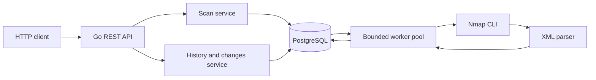
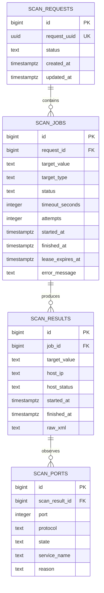

# Nmap REST API — Project Documentation

## 1. Project overview

This project accepts authorized Nmap scan requests, stores them for asynchronous processing, and provides recent scan observations and comparisons through a REST API. A request may contain several IP addresses or hostnames. The API validates the whole batch and stores one job per target in PostgreSQL before replying, so the HTTP request does not wait for Nmap to finish.

The project helps engineers investigate whether selected TCP ports appear reachable from the scanner's network location and see how observations changed over time. It does **not** inspect, change, or prove the configuration of firewall rules. A scan is an observation from the scanner's point of view; routing, host availability, network controls, and scan timing can affect what Nmap reports.

## 2. Technology stack

| Technology | Use in this project |
| --- | --- |
| Go 1.22 | HTTP server, validation and services, bounded workers, process execution, XML parsing, and database access. Go's contexts support cancellation/deadlines, and goroutines make a fixed-size worker pool straightforward. The Docker build produces a static Linux binary. |
| PostgreSQL 16 | Durable scan requests, per-target jobs, host results, and port observations. Transactions protect batch creation and result completion; row locking supports concurrent job claims. |
| Nmap CLI | Performs the actual network scan with a fixed TCP profile and emits machine-readable XML. Nmap is an assignment requirement and a mature scanner; it must be installed wherever the API runs. |
| Docker / Compose | Provides a repeatable local PostgreSQL and API environment. The API image installs Nmap in its Alpine runtime image. Compose is local orchestration, not a production cluster. |
| pgx v5 via `database/sql` | PostgreSQL driver. `go-sqlmock` is used for repository unit tests. |

Go and PostgreSQL are suitable for this MVP because the code needs bounded concurrency, context-aware process execution, transactional relational persistence, and concurrent queue-like claims. These are implementation benefits, not performance benchmarks. The application uses the Nmap CLI rather than implementing port scanning itself.

## 3. Project structure

- `cmd/api`: application entry point. Loads configuration, connects to PostgreSQL, constructs services and workers, starts HTTP and background processing, and handles shutdown signals.
- `cmd/nmap-demo`: standalone Nmap runner/parser demonstration; it is separate from the REST API.
- `internal/api`: HTTP routes, JSON decoding/encoding, method checks, request-size handling, and API error mapping. It does not contain SQL.
- `internal/service`: scan-submission validation and history/change comparison logic.
- `internal/domain`: shared request, job, result, port, and history data types.
- `internal/db`: PostgreSQL connection setup and repository queries/transactions, including job claiming, lease recovery, persistence, history, and changes queries.
- `internal/nmap`: safe argument-vector process invocation, timeout/cancellation handling, XML parsing, and Nmap result types.
- `internal/worker`: fixed-size worker pool, periodic lease recovery, and processing of a single job from Nmap execution through persistence.
- `migrations`: initial PostgreSQL schema and rollback SQL. The API does not run migrations at startup.
- `docs`: assignment requirements, API design, implementation plan, architecture, and this developer-facing guide.
- `Dockerfile`, `docker-compose.yml`, `.env.example`: container build, local services, and sample Compose settings.

A typical dependency direction is: HTTP handler → service → repository interface → PostgreSQL; workers → repository and Nmap runner/parser. The `domain` types pass data between these layers.

## 4. Architecture overview

The API and worker pool currently run in the same Go process. PostgreSQL is both the durable store and the pending-job queue. The worker count bounds concurrent Nmap processes in that process.



## 5. API documentation

All responses are JSON. The implemented endpoints are below.

### `POST /api/v1/scans`

Accepts a batch of targets and queues one independent job per target. The API returns after the request and all its jobs have been committed to PostgreSQL; it does not wait for scans to complete.

Request:

```json
{
  "targets": ["127.0.0.1", "::1"],
  "timeout_seconds": 60
}
```

`timeout_seconds` is optional; when omitted, `DEFAULT_TIMEOUT_SECONDS` is used. On success, the initial target statuses are `pending`:

```json
{
  "request_id": "6e0aa93a-4d0a-45ac-8ff0-ace0e1480e2c",
  "status": "accepted",
  "targets": [
    {"target": "127.0.0.1", "status": "pending"},
    {"target": "::1", "status": "pending"}
  ]
}
```

Returns `202 Accepted` when persisted. Errors include `400 Bad Request` for invalid JSON or validation failures and `500 Internal Server Error` for an unexpected persistence failure. Example validation error:

```json
{
  "error": {
    "code": "TARGET_NOT_ALLOWED",
    "message": "target \"example.com\" is not in SCAN_ALLOWED_TARGETS"
  }
}
```

### `GET /api/v1/targets/{target}/scans`

Returns up to the requested number of recent jobs and their observations, newest first. `limit` is optional and defaults to 20; the valid range is 1–100. The optional `state` parameter accepts `open`, `closed`, `filtered`, or `all`, case-insensitively. Without it, only open and closed observations are included; `state=all` includes all persisted states. Filtering changes only the returned `ports` arrays, not which scan jobs are selected, and scans whose ports are all filtered out remain in the response. Unsupported or repeated state values return `400 Bad Request`. A target with no matching history returns `200 OK` with `"scans": []`. History and changes timestamps are returned in IST (UTC+05:30); PostgreSQL stores the underlying timezone-aware instants.

Examples: `GET /api/v1/targets/127.0.0.1/scans?limit=10` or `GET /api/v1/targets/127.0.0.1/scans?limit=5&state=filtered`

```json
{
  "target": "127.0.0.1",
  "scans": [
    {
      "scan_id": 42,
      "started_at": "2026-11-05T17:30:00+05:30",
      "finished_at": "2026-11-05T17:30:18+05:30",
      "status": "completed",
      "resolved_ips": ["127.0.0.1"],
      "ports": [
        {
          "resolved_ip": "127.0.0.1",
          "port": 80,
          "protocol": "tcp",
          "state": "open",
          "service": "http",
          "reason": "syn-ack"
        }
      ]
    }
  ]
}
```

`scan_id` is the underlying `scan_jobs.id`. Timestamps can be `null` for a job that has not started or finished. `service` can be `null`; `reason` is omitted when absent. A result can have empty `resolved_ips` and `ports`, for example before a job has produced host results. Host status is stored in the database but is not included in the history JSON. Invalid targets and invalid limits return `400`; an unrecognized route returns `404`; an unexpected database error returns `500`. For example, an invalid `limit` returns:

```json
{"error":{"code":"INVALID_LIMIT","message":"limit must be between 1 and 100"}}
```

### `GET /api/v1/targets/{target}/changes`

Compares the latest pair of completed scans that have the same resolved-IP set and valid timestamps. Port identity is resolved IP + protocol + port number. A state or service change for an identity in both scans is reported in `changed_ports`.

Example response:

```json
{
  "target": "127.0.0.1",
  "previous_scan_id": 41,
  "current_scan_id": 42,
  "previous_started_at": "2026-11-05T16:30:00+05:30",
  "previous_finished_at": "2026-11-05T16:30:12+05:30",
  "current_started_at": "2026-11-05T17:30:00+05:30",
  "current_finished_at": "2026-11-05T17:30:18+05:30",
  "added_ports": [],
  "removed_ports": [],
  "changed_ports": [
    {
      "resolved_ip": "127.0.0.1",
      "port": 80,
      "protocol": "tcp",
      "previous_state": "filtered",
      "current_state": "open",
      "previous_service": "http",
      "current_service": "http"
    }
  ]
}
```

Each entry in `added_ports`/`removed_ports` has `resolved_ip`, `port`, `protocol`, `state`, and `service` (which may be `null`). No comparable pair returns `404 Not Found`:

```json
{"error":{"code":"NO_COMPARABLE_SCANS","message":"fewer than two comparable completed scans are available"}}
```

### Shared validation and error behavior

- A scan body must be one JSON value, no larger than 1 MiB, and contain no unknown fields. It requires at least one target and cannot exceed `MAX_BATCH_SIZE` targets.
- Targets must be an IPv4 address, IPv6 address, or ASCII hostname. Surrounding whitespace is rejected. Hostname labels are 1–63 characters, total hostname length is at most 253, and labels cannot start or end with `-`.
- Every target must match `SCAN_ALLOWED_TARGETS`. An empty or unset allowlist denies all scan requests. IP addresses are normalized for allowlist comparison; hostnames are lowercased and a trailing dot is ignored for comparison. Wildcards and CIDR entries are not supported.
- `timeout_seconds` must be between 1 and 120 inclusive. The batch is fully validated before any rows are written; one invalid or disallowed member rejects the whole submission.
- Common `400` codes are `INVALID_JSON`, `INVALID_REQUEST`, `BATCH_TOO_LARGE`, `INVALID_TIMEOUT`, `INVALID_TARGET`, `TARGET_NOT_ALLOWED`, `INVALID_LIMIT`, and `INVALID_STATE`.
- Unsupported methods return `405 Method Not Allowed` with an `Allow` header. Unknown routes return `404` with `{"error":{"code":"NOT_FOUND","message":"endpoint not found"}}`. Unexpected server errors return a generic `500` JSON message; details are logged rather than sent to clients.

## 6. End-to-end request flow

1. The handler limits and decodes the JSON body, then calls the scan service.
2. The service validates every target, timeout, batch size, and allowlist entry. It preserves the submitted target string for the job.
3. It generates a UUID and calls the repository once. A transaction inserts one `scan_requests` row and all `scan_jobs` rows. If any insert fails, the transaction rolls back.
4. After the transaction commits, the API returns `202 Accepted` with a request ID and each target marked `pending`.
5. Each worker independently polls PostgreSQL and claims one job. Different workers can execute different targets concurrently, up to `WORKER_COUNT` within this process.
6. The worker invokes Nmap, parses XML, and produces one stored host result per distinct resolved IP, with observed ports attached to that result.
7. A completion transaction verifies the claim, writes results and ports, marks the job completed, and updates the aggregate request status. Execution, timeout, parse, and persistence failures instead set a terminal job status when the claim is still valid.

One target failing does not cancel its siblings. Each target has its own job and outcome. The request aggregate remains `pending` while all jobs are pending, becomes `running` if any job is running or pending alongside terminal jobs, and after all jobs are terminal becomes `failed` if any failed, otherwise `timed_out` if any timed out, otherwise `completed`. The status is updated in PostgreSQL but there is no request-status API endpoint. Hostnames are syntax-validated at submission only; DNS lookup happens later as part of Nmap execution. Therefore a syntactically valid but unresolvable hostname can already have received `202` and then have an unsuccessful job outcome.

## 7. Nmap integration

The runner executes Nmap with a fixed argument list, passing the target as its own argument (not through a shell):

| Argument | Meaning |
| --- | --- |
| `-Pn` | Skip Nmap host discovery and treat targets as online for the scan. |
| `-T4` | Use Nmap's faster timing template. |
| `-sT` | Use TCP connect scanning. |
| `--top-ports 1000` | Scan the 1,000 most common ports in Nmap's TCP port-frequency data, not every possible port. |
| `-oX -` | Write XML output to standard output. |
| `<target>` | The IP or hostname submitted for this job. Nmap resolves hostnames during execution. |

XML is used because it is structured and can be parsed without scraping human-readable output. The parser reads run/host timestamps, IPv4/IPv6 addresses, host status, port number, protocol, state, service name, and reason. It also expands `<extraports>` observations when nested `<extrareasons>` provides a protocol and an exact port list, using the aggregate state and matching reason. Listed counts are validated, duplicate observations are avoided, and an individual `<port>` entry takes precedence. Aggregate counts without exact membership are not expanded into guessed ports. A hostname can resolve to multiple IPs; the output is represented as observations for the IPs found in Nmap's XML. The parser preserves Nmap state strings, including `open`, `closed`, `filtered`, and combined values such as `open|filtered`; it does not infer a state for a port absent from both individual entries and exact aggregate membership lists.

A malformed target is rejected synchronously with `400`. A valid target that is down or does not respond is a network observation, not automatically an invalid target or process failure. If Nmap exits unsuccessfully or its XML cannot be parsed, the job is `failed`; if the per-scan timeout elapses, it is `timed_out`. A scan whose XML says a host is down may still be a completed scan job with a down host observation. The runner captures stderr separately for diagnostics. Per-scan timeouts are capped at 120 seconds; parent cancellation/deadline is distinguished from the scan timeout.

## 8. Database design

The initial schema is defined in `migrations/001_init.up.sql` and rolled back by `migrations/001_init.down.sql`.



- `scan_requests` groups a submitted batch and stores its unique UUID and aggregate status.
- `scan_jobs` stores one target per job, its status, timeout, retry attempt count, error text, and lease timestamps. `target_type` is constrained to `ip` or `hostname`; statuses are constrained to `pending`, `running`, `completed`, `failed`, and `timed_out`.
- `scan_results` stores a host observation linked to a job, including resolved IP, host status, times, and raw XML. Multiple resolved IPs can create multiple rows for one job; raw XML is stored on each result row.
- `scan_ports` stores each observed port and its protocol, state, optional service name, and optional reason.
- Foreign keys cascade deletes from request → jobs → results → ports. Uniqueness prevents duplicate `(job_id, host_ip)` results and duplicate `(scan_result_id, port, protocol)` observations.
- The migration also creates `idx_scan_jobs_request_id`, `idx_scan_jobs_status_created_at`, `idx_scan_jobs_target_value`, and `idx_scan_results_host_ip_finished_at`. Unique constraints on `request_uuid`, `(job_id, host_ip)`, and `(scan_result_id, port, protocol)` create unique indexes. There is no separate migration/version table.
- The schema restricts request/job statuses to `pending`, `running`, `completed`, `failed`, or `timed_out`; it restricts job target types to `ip` or `hostname` and disallows an empty port state. Other port-state values are preserved as text rather than mapped to a fixed enum.

Recent history includes job status/times and any stored host/port observations. The limit applies to jobs before the `/scans` response state filter. Changes has no state filter and compares all persisted observations, including filtered and combined states, only when the resolved-IP sets match. The diff keys ports by resolved IP, protocol, and number; it reports state/service changes and additions/removals from the scan output. For comparison, IPs must be `up` in both scans. A port missing in a later scan is not relabeled `closed`; if the IP was up in both scans, the current implementation can report that prior observation as removed, which is not proof of a firewall closure. A down host is excluded from port comparison.

## 9. Concurrency and reliability

- The pool starts a fixed number of workers plus one lease-recovery loop. Each worker handles one target at a time and polls every 250 ms when idle. Compose configures four workers by default.
- A short database transaction selects the oldest pending job using `FOR UPDATE SKIP LOCKED`, marks it `running`, increments attempts, and assigns a 150-second lease. Nmap runs after that transaction closes, so a long scan does not hold a database lock.
- Completion and failure updates check a timestamp claim token made from `started_at` and `lease_expires_at` along with job ID and running status. Completion locks and verifies the claim before writing. This fences off a worker whose job has been recovered/reclaimed; it is a timestamp-based token, not a separate random token.
- A recovery loop runs every 15 seconds. Expired jobs below three attempts return to `pending`; after the third claim expires, the job becomes `failed`. The 120-second maximum scan timeout is below the 150-second lease. There is no lease renewal.
- Ordinary Nmap, XML, and persistence failures are not retried automatically; only expired running leases are retried. A stale claim cannot write results. Result replacement is transactional.
- On SIGINT/SIGTERM, the process cancels workers (which cancels in-flight Nmap processes), asks the HTTP server to shut down with a 10-second limit, waits for workers, then closes the database. A canceled in-flight job remains leased/running for later recovery rather than being marked failed due solely to shutdown.
- Request/job insertion and result/port completion are transactional. Each target is independent, so a failed scan does not block or cancel other jobs in its batch. Aggregate request status reflects all child jobs, but is not exposed by an endpoint.

## 10. Configuration and running locally

### Prerequisites

For Compose: Docker with the Compose plugin. For running the API directly: Go 1.22+, PostgreSQL, and Nmap available on `PATH`. The application itself does not read `.env`; Compose performs `.env` interpolation.

### Environment variables

| Variable | Required? | Default / purpose |
| --- | --- | --- |
| `API_HOST` | No | `0.0.0.0`; listen address host. |
| `API_PORT` | No | `8080`; must be positive. |
| `DB_HOST` | Yes | PostgreSQL host. |
| `DB_PORT` | No | `5432`; must be positive. |
| `DB_USER` | Yes | PostgreSQL username. |
| `DB_PASSWORD` | Yes | PostgreSQL password. |
| `DB_NAME` | Yes | PostgreSQL database name. |
| `DB_SSLMODE` | No | `disable`. |
| `WORKER_COUNT` | No | `4`; must be positive. |
| `MAX_BATCH_SIZE` | No | `20`; must be positive. |
| `DEFAULT_TIMEOUT_SECONDS` | No | `120`; effective configured default must be 1–120 seconds. |
| `SCAN_ALLOWED_TARGETS` | No | Empty/unset denies all scan requests. Comma-separated exact IPs/hostnames; empty entries are configuration errors. |
| `APP_ENV` | No | `development`; currently loaded but does not change application behavior. |
| `POSTGRES_HOST_PORT` | Compose only | `5432`; host-side published PostgreSQL port. |

Compose sets API/database connection values and reads `DB_USER`, `DB_NAME`, and `DB_PASSWORD` from `.env` interpolation. `.env.example` provides local sample values, including loopback targets; replace them with only systems you are authorized to scan. The allowlist is not authentication.

### Start and migrate

1. Copy `.env.example` to `.env`, set a unique local `DB_PASSWORD`, and set the exact authorized scan targets.
2. Start the services: `docker compose up --build -d`.
3. Apply the migration manually; the API does not create tables automatically. With the default Compose database credentials:

   `docker compose exec -T postgres psql -U appuser -d nmapdb < migrations/001_init.up.sql`

   If `DB_USER` or `DB_NAME` was changed in `.env`, substitute those values. Apply the migration once per new database.
4. Submit a local test scan (only if `127.0.0.1` is in the allowlist):

   `curl -i -X POST http://localhost:8080/api/v1/scans -H 'Content-Type: application/json' -d '{"targets":["127.0.0.1"],"timeout_seconds":30}'`

   Expect `202 Accepted`. The response means persisted/queued, not completed. Retrieve observations later with `curl 'http://localhost:8080/api/v1/targets/127.0.0.1/scans'`.
5. Inspect services and logs with `docker compose ps` and `docker compose logs -f api`. To inspect rows, use `docker compose exec postgres psql -U appuser -d nmapdb` and query `scan_requests`, `scan_jobs`, `scan_results`, or `scan_ports`.

`docker compose down` stops services while retaining the named PostgreSQL volume. `docker compose down -v` also deletes its database data.

To run the API directly, start/configure PostgreSQL, apply the migration, export the required `DB_*` values and desired `SCAN_ALLOWED_TARGETS`, ensure Nmap is installed, then run `go run ./cmd/api`. Direct execution does not load `.env` automatically.

## 11. Testing

The repository has tests for:

- API method handling, JSON responses, accepted batches, target/timeout/batch validation, history limits and state filters, and changes.
- Configuration parsing and empty/malformed allowlist entries.
- Nmap argument construction, XML/stderr separation, process failures, timeout, parent cancellation, and parent deadline.
- XML parsing of multiple IPv4/IPv6 hosts, individual and exact-membership aggregate port states, missing ports, malformed XML/fields, and timestamps, using fixtures under `internal/nmap/testdata`.
- Scan/history service behavior, target matching, and port change semantics (including not synthesizing `closed`).
- Repository transaction/rollback behavior and SQL expectations using `go-sqlmock`.
- Worker processing, independent target failures, shutdown cancellation, timeout handling, and periodic recovery.
- PostgreSQL integration tests (build-tagged `integration`) for concurrent claims, lease retries/fencing, aggregation, migrations, result replacement, and history queries. They require a PostgreSQL connection configured by `DB_PASSWORD` and optional `DB_HOST`, `DB_PORT`, `DB_USER`, `DB_NAME`, and `DB_SSLMODE`; the database user must be allowed to create schemas. Tests create an isolated schema and apply the migration within it.
- API shutdown ordering in `cmd/api`.

Run unit tests with `go test ./...`. Run PostgreSQL integration tests with `go test -tags=integration ./internal/db` after configuring a test database. These commands are documented for developers; tests were not run as part of this documentation-only change.

## 12. Limitations and future improvements

Implemented functionality is limited to the fixed top-1,000 TCP scan profile, a single-process bounded worker pool, PostgreSQL-backed jobs, the three documented API routes, and basic process logging. There is no authentication, request-status endpoint, migration runner, broker, distributed worker deployment, rate limiting, global queue limit, metrics endpoint, tracing, or proof of firewall configuration. The MVP has not been benchmarked for high throughput and does not claim support for one million requests per second.

Potential future work—only if the deployment needs it—includes authentication and authorization, outbound-network restrictions, queue admission control, structured telemetry, migration versioning, separate API and worker deployments, a broker with an outbox, read replicas, partitioning, object storage for large raw XML, and selective caching. These are proposals, not current features. See [architecture.md](architecture.md) for the scalability discussion.
